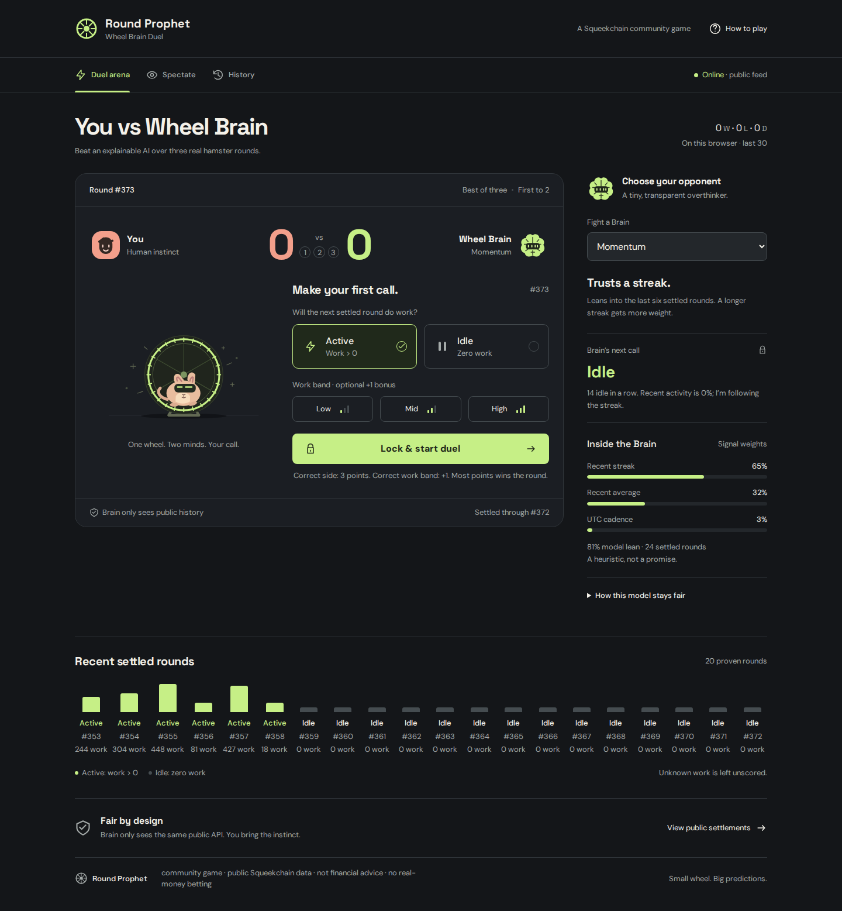

# Round Prophet · Wheel Brain Duel

An original, browser-only prediction game for Squeekchain Genesis Code: challenge Wheel Brain over up to three real hamster-wheel settlements. Pick a transparent persona, lock your calls, and try to **break the Brain**. No account or wallet is required.



## Run and rebuild

Use Node.js 22.18 or newer (Node 24 recommended).

```sh
npm ci
npm run dev
```

For the production export:

```sh
npm run typecheck
npm test
npm run build
npm run preview
```

Open the URL printed by Vite. `dist/index.html` and its complete local assets are included in this delivery; a static publisher serves **dist/** directly. Vite uses `base: './'`, local fonts and assets, and hash navigation, so the export works under a gateway subpath without a server rewrite. Do not serve the source `index.html` as the built site.

The source and committed-export handoff are ready for the assignment’s repository and HTTPS publisher. Public GitHub and hosted-site URLs are assigned after review; no deployment URL or repository URL is invented here.

## Play a duel

1. Choose **Momentum**, **Mean-revert**, or **Timekeeper**. On a phone, the selector is at the top of the arena.
2. Predict the **next settled round**: **Active** means work greater than zero; **Idle** means exactly zero. An Active call may include a Low, Mid, or High work band.
3. Select **Lock & start duel**. The feed is checked again before accepting the call. If that round just settled, review the new round and lock again.
4. Return to lock your prediction for each following consecutive round. The match cannot skip forward to an easier round. A missed call is an explicit forfeit.
5. First to **2 round wins** ends the duel. After three rounds, the larger round-win count wins. Equal counts produce a draw, because real tied calls should not produce an invented winner.

A correct side earns **3 points**. A correct work band adds **1 point**, only with a correct Active side. Higher points wins the round; equal points tie and award no round win. Thus a wrong side can never beat a correct side. Bands use the nearest-rank one-third and two-thirds quantiles of positive work in the most recent 60 provable settled rounds; boundaries are inclusive and repeated values stay together. Zero-work rounds have no band bonus. The disclosure below the model gives the exact thresholds.

Brain commits **all three** of its forecasts when the match starts. Its history cutoff, reasoning, weights, and the band thresholds stay fixed throughout that duel. The player locks one call per round before its settlement. This precommitment prevents hindsight calls if several rounds settle while the tab is away. An unused third round after a 2–0 win is marked “Not needed.”

Real Squeekchain rounds are approximately ten minutes, and confirmation can take longer. This is a real-time game, not an accelerated simulation. A round can already be closed while awaiting settlement; the target is the next unanchored round. No optimistic work, current wheel speed, projected builder state, or queued round total is used to decide a result.

## The three Brains

All models are deterministic client-side heuristics in [`src/engine.ts`](src/engine.ts), with no paid AI service. “Model lean” is an explanation of the model’s weighted signal, **not a calibrated probability** or a claim of historical accuracy.

| Persona     | What it reads                                                                                    | How it thinks                                                                                                              |
| ----------- | ------------------------------------------------------------------------------------------------ | -------------------------------------------------------------------------------------------------------------------------- |
| Momentum    | Last six confirmed rounds, the trailing Active/Idle streak, recent baseline, public UTC cadence  | Follows the streak. Streak weight grows from 48% to a maximum 65%; baseline gets 32% and cadence gets the remainder.       |
| Mean-revert | Recent activity versus the last 60 provable rounds                                               | Fades an unusually hot or cold streak. Weights are 15% recent streak, 65% reversion toward the baseline, 20% cadence.      |
| Timekeeper  | The matching UTC half-hour in seven-day public measurement history, plus recent settled activity | Weights are 20% streak, 20% baseline, 60% cadence. Public half-hour work is a cadence proxy, not exact per-round outcomes. |

Missing UTC history moves that weight to the baseline. The model card explains the current call and displays weights that sum to 100%. For Active bands, Brain classifies a recent mean active-work estimate, adjusted by persona, against the same frozen thresholds as the player. All arithmetic involving round IDs or work remains `bigint` or a decimal string; only bounded ratios and display percentages become numbers.

## Public data and fairness

The only runtime network source is `https://api.squeekchain.com`:

- [`/v1/status`](https://api.squeekchain.com/v1/status): poll approximately every two seconds after the preceding request completes. `builder.anchor.settledThroughRound` gates scoring.
- [`/v1/settlements?range=now`](https://api.squeekchain.com/v1/settlements?range=now): load at startup, on anchor changes, about every ten seconds, and before locking.
- [`/v1/measurement/stats?range=7d`](https://api.squeekchain.com/v1/measurement/stats?range=7d): public cadence history, refreshed at startup, every minute, on anchor changes, and before locking.

[`src/data.ts`](src/data.ts) parses JSON using `lossless-json`, including unquoted integers beyond JavaScript’s safe range. It reconstructs per-round work from cumulative ledger boundaries in safe settlements, safe mining checkpoints exposed by the settlement endpoint, and the confirmed builder anchor. Consecutive boundaries prove their exact difference. Equal cumulative boundaries prove all intervening rounds had zero work. Positive work spanning multiple rounds is **never divided or guessed**. Zero token issuance alone is never treated as proof of idle work.

The round rail shows up to 20 proven rounds; fewer are shown when the API supplies less proof. Up to 256 proven rounds stay in memory during a session. Unknown per-round work remains pending even after the anchor advances. A later response may supply the missing proof; otherwise the game stays paused for that result rather than fabricating a settlement.

**Online** requires fresh status, an online measurement, live settlement history, matching installation IDs, and sufficiently recent history. An API failure shows **Offline**; stale readings or a durable-cache settlement response show **Stale**. Both states pause new locks and result scoring. Retry and automatic polling recover the feed. When confirmed data returns, genuinely settled locked rounds resolve, and uncalled consecutive rounds count as forfeits. A backward anchor or conflicting cumulative values pauses play.

## Spectate, history and sharing

**Spectate** saves a Brain call before settlement and grades that side against the same confirmed data. It does not invent forecasts for rounds that passed before the browser was watching. Calls from other personas remain in the local call sheet.

The last 30 completed matches, the current duel, and the last 30 spectator calls live under `round-prophet:season:v1` in localStorage. This is a local matchbook, not a shared leaderboard or tamper-proof record. Refresh restores calls. If storage is blocked, the game explains that the tab must stay open. Clearing browser data clears the record; use one active game tab for a predictable local season.

After victory, defeat, or draw, **Save share card** exports a locally rendered **1200×630 PNG**. **Copy match text** includes the persona, score, and exact played round range. If the Clipboard API is unavailable, a selectable text field appears. Past matches can reopen their card from History. Fonts and art are local; no image-generation or remote image service runs in the game.

## Check the site

```sh
npm test
npx playwright install chromium
npm run build
npm run test:browser
```

The browser test serves the actual export at `/preview/`, uses explicitly synthetic API fixtures, and closes its server and browser when finished. Test data is never imported by the game. It checks complete 2–1 and 2–0 duels, defeat, draw, immutable Brain calls, reloads, bands, missed calls, API outage and stale states, a settlement racing a lock, spectator grading, PNG export, clipboard text, match history, keyboard focus, reduced motion, and accessibility with axe. It also checks 320, 390, 760, 1024, and 1440 widths, the first phone screen, and 200% CSS text enlargement.

Actual worker results: **production build passed; strict TypeScript check passed; 17 engine/data tests passed; 11 browser scenarios passed; 16/16 taste@1 checks passed; zero axe violations in the checked states**. Live public responses also produced proven rounds, working persona selection, a real call lock, and restoration after reload. Full details, source findings, exact commands, screenshots, and limits are in [`artifacts/validation.md`](artifacts/validation.md). These are worker observations, not independent certification.

Browser limits: the supplied browser launcher could not start; the installed headless Chromium was used instead. Direct browser egress to the API failed in this environment, so the live-data browser check forwarded the same official requests through curl without altering their data. Separate interaction tests use labeled synthetic fixtures. WebKit could not run because required system libraries are absent. Physical iPhone/Safari, native browser 200% zoom, and a real screen-reader session were not verified. The 200% check enlarged CSS text, not browser chrome. A full live match was not awaited; complete settlement flows were exercised with deterministic fixtures.

## Source map and design

- [`src/engine.ts`](src/engine.ts): personas, quantiles, scoring, consecutive match resolution, share text.
- [`src/data.ts`](src/data.ts): lossless parsing, API adaptation, cumulative proof, freshness.
- [`src/useGame.ts`](src/useGame.ts): polling, locking, spectator calls, persistence and recovery.
- [`src/App.tsx`](src/App.tsx): arena, modes, model cards, matchbook and rules dialog.
- [`src/components/Art.tsx`](src/components/Art.tsx): original hamster, wheel, avatars and icons.
- [`src/components/ShareCard.tsx`](src/components/ShareCard.tsx): local canvas export and clipboard fallback.
- [`DESIGN.md`](DESIGN.md): the final implemented tokens, typography, components and responsive behavior.
- [`scripts/generate-social.mjs`](scripts/generate-social.mjs): rebuild the included original social PNG/SVG with `npm run social` after installing Chromium.
- [`THIRD_PARTY.md`](THIRD_PARTY.md): font, dependency and design-guidance attribution.

## Submission path budget

The export, source, documentation, local runtime assets, manifests and lockfile must fit the assignment’s **8 MiB** added-file budget. The final measured inventory is recorded in [`artifacts/submission-budget.json`](artifacts/submission-budget.json).

The explicit `.gitignore` budget is **0 submitted bytes** for each of `**/node_modules/`, `**/.npm/`, `**/.vite/`, `**/.cache/`, `**/coverage/`, and `/test/scratch/`. These paths contain generated dependencies, caches or temporary evidence only. Nothing under `dist/`, source, fonts, or necessary configuration is ignored. No dependency archives, registry mirror, submodule, or private runtime configuration is part of the delivery.

community game · public Squeekchain data · not financial advice · no real-money betting

The explicit inclusion budget for `/artifacts/**` is **2 MiB**, enforced by `npm run budget`. This keeps the actual validation reports and screenshots in the Git handoff even when inherited ignore rules omit artifact directories. Dependency/cache exclusions still apply at every nesting level, including inside artifacts.
